<!-- generated by generator/make_readme.py — edit there, then re-run -->

<!-- section:hero -->
<picture>
  <source media="(prefers-color-scheme: dark)" srcset="./assets/hero-dark.svg">
  <source media="(prefers-color-scheme: light)" srcset="./assets/hero-light.svg">
  
</picture>
<!-- /section:hero -->

<!-- section:links -->

  <a href="https://majdb.com">
    <picture>
      <source media="(prefers-color-scheme: dark)" srcset="./assets/btn-site-dark.svg">
      <source media="(prefers-color-scheme: light)" srcset="./assets/btn-site-light.svg">
      
    </picture>
  </a>
  <a href="https://cal.com/glorybnat">
    <picture>
      <source media="(prefers-color-scheme: dark)" srcset="./assets/btn-cal-dark.svg">
      <source media="(prefers-color-scheme: light)" srcset="./assets/btn-cal-light.svg">
      
    </picture>
  </a>

<!-- /section:links -->

<!-- section:about -->
<picture>
  <source media="(prefers-color-scheme: dark)" srcset="./assets/header-about-dark.svg">
  <source media="(prefers-color-scheme: light)" srcset="./assets/header-about-light.svg">
  
</picture>

<picture>
  <source media="(prefers-color-scheme: dark)" srcset="./assets/terminal-dark.svg">
  <source media="(prefers-color-scheme: light)" srcset="./assets/terminal-light.svg">
  
</picture>
<!-- /section:about -->

<!-- section:projects -->
<a href="https://majdb.com/projects">
<picture>
  <source media="(prefers-color-scheme: dark)" srcset="./assets/header-projects-dark.svg">
  <source media="(prefers-color-scheme: light)" srcset="./assets/header-projects-light.svg">
  
</picture>
</a>

  <a href="https://majdb.com/projects/radar">
    <picture>
      <source media="(prefers-color-scheme: dark)" srcset="./assets/card-radar-dark.svg">
      <source media="(prefers-color-scheme: light)" srcset="./assets/card-radar-light.svg">
      
    </picture>
  </a>
  <a href="https://majdb.com/projects/gptthoughts">
    <picture>
      <source media="(prefers-color-scheme: dark)" srcset="./assets/card-gptthoughts-dark.svg">
      <source media="(prefers-color-scheme: light)" srcset="./assets/card-gptthoughts-light.svg">
      
    </picture>
  </a>
  <a href="https://majdb.com/projects/bracken">
    <picture>
      <source media="(prefers-color-scheme: dark)" srcset="./assets/card-bracken-dark.svg">
      <source media="(prefers-color-scheme: light)" srcset="./assets/card-bracken-light.svg">
      
    </picture>
  </a>
  <a href="https://majdb.com/projects/classly">
    <picture>
      <source media="(prefers-color-scheme: dark)" srcset="./assets/card-classly-dark.svg">
      <source media="(prefers-color-scheme: light)" srcset="./assets/card-classly-light.svg">
      
    </picture>
  </a>

<!-- /section:projects -->

<!-- section:radar -->
<picture>
  <source media="(prefers-color-scheme: dark)" srcset="./assets/header-radar-dark.svg">
  <source media="(prefers-color-scheme: light)" srcset="./assets/header-radar-light.svg">
  
</picture>

<picture>
  <source media="(prefers-color-scheme: dark)" srcset="./assets/radar-dark.svg">
  <source media="(prefers-color-scheme: light)" srcset="./assets/radar-light.svg">
  
</picture>
<!-- /section:radar -->

<!-- section:monogram -->

  <picture>
    <source media="(prefers-color-scheme: dark)" srcset="./assets/logo3d-dark.svg">
    <source media="(prefers-color-scheme: light)" srcset="./assets/logo3d-light.svg">
    
  </picture>

<!-- /section:monogram -->

<!-- section:writing -->
<a href="https://majdb.com/articles">
<picture>
  <source media="(prefers-color-scheme: dark)" srcset="./assets/header-writing-dark.svg">
  <source media="(prefers-color-scheme: light)" srcset="./assets/header-writing-light.svg">
  
</picture>
</a>

- `2026-08-02` &nbsp;[Day 16 — systemd Service Management](https://majdb.com/articles/day-16-systemd-service-management) · 7 min read
- `2026-02-28` &nbsp;[Day 15 — Scheduling with cron and systemd timers](https://majdb.com/articles/day-15-scheduling-with-cron-and-systemd-timers) · 6 min read
- `2026-02-27` &nbsp;[Day 14 — Shell Scripting Basics](https://majdb.com/articles/day-14-shell-scripting-basics) · 8 min read

part of the <b>Learn Linux in 30 Days</b> series on <a href="https://majdb.com/articles">majdb.com</a>
<!-- /section:writing -->

<!-- section:activity -->
<a href="https://github.com/glorybnat">
<picture>
  <source media="(prefers-color-scheme: dark)" srcset="./assets/header-activity-dark.svg">
  <source media="(prefers-color-scheme: light)" srcset="./assets/header-activity-light.svg">
  
</picture>
</a>

  <picture>
    <source media="(prefers-color-scheme: dark)" srcset="https://streak-stats.demolab.com?user=glorybnat&hide_border=true&background=00000000&stroke=ededf017&ring=66a5ff&fire=66a5ff&currStreakNum=ededf0&sideNums=ededf0&currStreakLabel=66a5ff&sideLabels=ededf080&dates=ededf080&border_radius=12">
    <source media="(prefers-color-scheme: light)" srcset="https://streak-stats.demolab.com?user=glorybnat&hide_border=true&background=00000000&stroke=18181b14&ring=1f6dd8&fire=1f6dd8&currStreakNum=18181b&sideNums=18181b&currStreakLabel=1f6dd8&sideLabels=18181b8c&dates=18181b8c&border_radius=12">
    
  </picture>

<!-- /section:activity -->

<!-- section:footer -->
<picture>
  <source media="(prefers-color-scheme: dark)" srcset="./assets/footer-dark.svg">
  <source media="(prefers-color-scheme: light)" srcset="./assets/footer-light.svg">
  
</picture>
<!-- /section:footer -->
